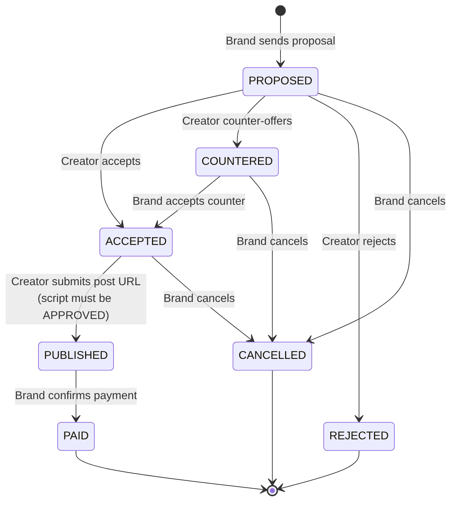
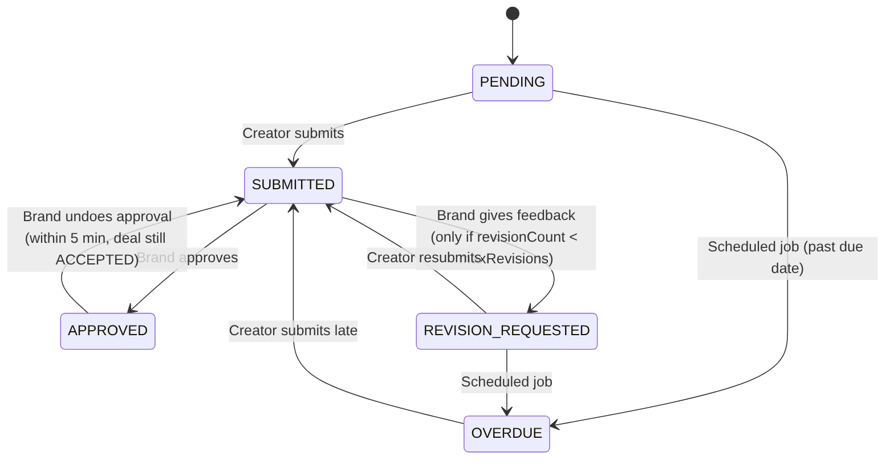
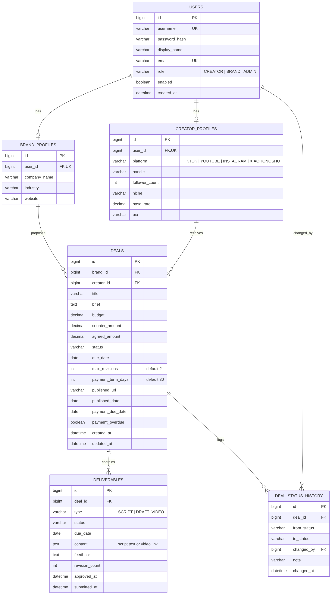

# CollabDesk — Requirements & Design (v0.1)

> A web platform for video creators and brands to manage sponsored-content collaborations,
> from the first proposal to the final payment.

## 1. Problem

Small and mid-sized creators usually handle brand deals over DMs, email, and spreadsheets.
Industry reports and creator discussions point to four recurring pain points:

| # | Pain point | Evidence | CollabDesk feature |
|---|---|---|---|
| P1 | **Late payment** | In a 2024 survey of 500+ influencers, 48% had been paid late that year; of those, 38.5% waited more than a month, and 55% said they were unlikely to work with that brand again [1]. Campaign (2025) reports payment terms of Net 30/60/90 and one deal that took four months to pay out [2]. | Payment due date set automatically when the video is published; a daily job flags overdue payments on both dashboards |
| P2 | **Unlimited revisions & scope creep** | Collaborations are "increasingly derailed by vague 'unlimited revisions' clauses"; many small notes add up to a re-shoot without extra budget. A common practice is to include about two revision rounds in the fee [3]. | Each deal has a `maxRevisions` limit agreed in the proposal; further revision requests are blocked |
| P3 | **Feedback limbo / missed deadlines** | Without review deadlines, projects stall [3]. | Every deliverable has a due date; overdue items are flagged automatically |
| P4 | **Scattered communication** | Small creators below platform thresholds (e.g. under 5,000 followers on Xiaohongshu's Pugongying) cannot use official deal platforms and rely on one-to-one DMs [4]; manual tracking across DMs and spreadsheets becomes messy as volume grows [5]. Newcomers are also often low-balled on rates [2]. | One shared deal page with status, negotiation record (budget → counter → agreed), and full audit history |

**Goal:** give both sides one shared place where every deal has a clear status, a full
history, explicit deadlines, a revision limit, and a tracked payment step.

References
1. Lumanu (2024). *Insights from 500+ influencers on their payment experience.* https://www.lumanu.com/blog/insights-from-500-influencers-on-their-payment-experience
2. Campaign US (2025, Sep 3). *New Campaign report reveals why creators still aren't getting paid on time.* https://campaignlive.com/article/new-campaign-report-reveals-why-creators-arent-getting-paid-time/1930824
3. Influencer Marketing Hub. *Influencer collaborations: revision limits.* https://influencermarketinghub.com/influencer-collaborations-revision-limits/
4. Jiemian News (2022, Feb 14). 《小红书把素人的车门给"焊死"了？》 https://www.jiemian.com/article/7099917.html
5. Make Influence. *Why manual influencer marketing becomes messy.* https://www.makeinfluence.com/academy-articles/why-manual-influencer-marketing-becomes-messy

## 2. Roles

| Role | Who | Main abilities |
|---|---|---|
| CREATOR | Video creator (TikTok / YouTube / Instagram / Xiaohongshu…) | Maintain profile & rate, respond to proposals (accept / reject / counter), submit script & draft, publish, view earnings |
| BRAND | Marketing staff of a company | Browse creators, send proposals, accept counter-offers, review deliverables, confirm payment, cancel deals |
| ADMIN | Platform operator | Manage users (enable/disable), view all deals and platform statistics |

## 3. User Stories (MVP)

**Creator**
- C1. As a creator, I can register and set up my profile (platform, handle, followers, niche, base rate).
- C2. I can see incoming proposals and **accept**, **reject**, or **counter-offer** with a new amount.
- C3. I can submit a **script** for an accepted deal and see the brand's feedback.
- C4. I can resubmit after a revision request (revision count is tracked).
- C5. I can mark a deal as **published** by submitting the post URL (only after the script is approved).
- C6. My dashboard shows active deals, upcoming deadlines, overdue items, and earnings this month.

**Brand**
- B1. As a brand, I can browse and filter the creator directory (platform, niche, rate range).
- B2. I can send a proposal (title, brief, budget, deadline, max revision rounds, payment terms in days) to a creator.
- B3. I can accept a creator's counter-offer or cancel the deal.
- B4. I can approve a deliverable or request a revision with feedback.
- B5. I can confirm payment after the video is published, which closes the deal.
- B6. I can **undo an approval within 5 minutes** in case I clicked Approve by mistake (added after usability testing; only possible before the creator publishes).

**Admin**
- A1. I can list, enable, and disable user accounts.
- A2. I can view all deals and basic statistics (deals by status, total deal value).

**System**
- S1. Illegal status transitions are rejected (e.g. PROPOSED → PAID).
- S2. Every status change is recorded in an audit history (who, when, from → to, note).
- S3. A scheduled job marks deliverables past their due date as OVERDUE every day.
- S4. Revision requests beyond the deal's `maxRevisions` are rejected (P2).
- S5. When a deal is PUBLISHED, `paymentDueDate = publishedDate + paymentTermDays`; the daily job
  flags unpaid deals past that date as payment-overdue, shown in red on both dashboards (P1).

## 4. Deal Lifecycle (State Machine)



<sub>Source: [`diagrams/deal-state-machine.mmd`](diagrams/deal-state-machine.mmd) (Mermaid)</sub>

| From | To | Who | Guard |
|---|---|---|---|
| PROPOSED | ACCEPTED | Creator | agreedAmount = budget |
| PROPOSED | COUNTERED | Creator | counterAmount > 0 |
| PROPOSED | REJECTED | Creator | — |
| COUNTERED | ACCEPTED | Brand | agreedAmount = counterAmount |
| PROPOSED / COUNTERED / ACCEPTED | CANCELLED | Brand | — |
| ACCEPTED | PUBLISHED | Creator | script deliverable APPROVED, valid URL |
| PUBLISHED | PAID | Brand | — |

Deliverable lifecycle (inside an ACCEPTED deal):



<sub>Source: [`diagrams/deliverable-state-machine.mmd`](diagrams/deliverable-state-machine.mmd) (Mermaid)</sub>

## 5. Database Design



<sub>Source: [`diagrams/er-diagram.mmd`](diagrams/er-diagram.mmd) (Mermaid)</sub>

Design notes
- `USERS` holds login data only; role-specific data lives in separate profile tables (1:1),
  so a creator and a brand don't share nullable columns.
- `budget` / `counter_amount` / `agreed_amount` are kept separately so the negotiation is traceable.
- Money uses `DECIMAL(10,2)` (Java `BigDecimal`), never `double`.
- When a deal becomes ACCEPTED, the system auto-creates a SCRIPT deliverable (and an optional DRAFT_VIDEO).

## 6. Architecture

```
Browser (Thymeleaf + Bootstrap)          Postman / Swagger UI
        │  form posts, session cookie            │  JSON
        ▼                                         ▼
  Web MVC Controllers (/creator/**, /brand/**, /admin/**)   REST Controllers (/api/**)
        └──────────────────┬──────────────────────┘
                     Service layer  (DealService = state machine + business rules,
                                     DeliverableService, DashboardService, OverdueScheduler)
                           │
                   Repository layer (Spring Data JPA)
                           │
                  H2 (dev)  /  MySQL 8 (prod, via profile)
Spring Security: form login, BCrypt, role-based URL rules + method checks (owner-only access)
```

Planned design patterns to discuss in the report: Layered architecture, DTO, Repository,
State (deal transitions), Template Method (JpaRepository), Proxy (@Transactional),
Singleton (Spring beans), Observer-style auditing (history written on every transition).

## 7. Pages

| Page | URL | Role |
|---|---|---|
| Sign in / Register | `/login`, `/register` | public |
| Creator dashboard (stats, needs-action list, deadlines) | `/creator/dashboard` | CREATOR |
| Creator profile | `/creator/profile` | CREATOR |
| Brand dashboard | `/brand/dashboard` | BRAND |
| Creator directory (filter by platform / niche / rate) | `/brand/creators` | BRAND |
| New proposal | `/brand/deals/new?creatorId=` | BRAND |
| Deal list (status filter) | `/deals` | all (own deals; admin sees all) |
| Deal detail: terms, deliverables, role-specific actions, history timeline | `/deals/{id}` | owner / admin |
| Admin overview + "run overdue check" | `/admin/dashboard` | ADMIN |
| User management (enable / disable) | `/admin/users` | ADMIN |

## 8. REST API (for Swagger / Postman demo)

| Method | Endpoint | Role | Description |
|---|---|---|---|
| GET | `/api/creators?platform=&niche=&maxRate=` | BRAND | Search creators |
| POST | `/api/deals` | BRAND | Create proposal |
| GET | `/api/deals?status=` | CREATOR/BRAND | My deals |
| GET | `/api/deals/{id}` | owner | Deal detail + history |
| POST | `/api/deals/{id}/accept` | CREATOR/BRAND | Accept proposal / counter |
| POST | `/api/deals/{id}/counter` | CREATOR | Counter-offer `{amount, note}` |
| POST | `/api/deals/{id}/reject` | CREATOR | Reject |
| POST | `/api/deals/{id}/cancel` | BRAND | Cancel |
| POST | `/api/deals/{id}/publish` | CREATOR | Submit post URL |
| POST | `/api/deals/{id}/pay` | BRAND | Confirm payment |
| POST | `/api/deliverables/{id}/submit` | CREATOR | Submit content |
| POST | `/api/deliverables/{id}/approve` | BRAND | Approve |
| POST | `/api/deliverables/{id}/undo-approve` | BRAND | Undo approval (5-minute window) |
| POST | `/api/deliverables/{id}/revise` | BRAND | Request revision `{feedback}` |
| GET | `/api/admin/stats` | ADMIN | Platform statistics |

Errors return a consistent JSON body via `@RestControllerAdvice`
(e.g. `409 Conflict` for an illegal transition, `403` for accessing someone else's deal).

## 9. Out of Scope (→ Future Enhancements)

Real payment gateway, email/Telegram notifications, file upload for video drafts,
analytics pulled from platform APIs (views, engagement), in-app chat, contract PDF generation.

## 10. Demo Accounts (seed data)

| Username | Password | Role |
|---|---|---|
| creator_amy | pass123 | CREATOR |
| creator_ken | pass123 | CREATOR |
| brand_bubbletea | pass123 | BRAND |
| brand_techgear | pass123 | BRAND |
| admin | admin123 | ADMIN |
